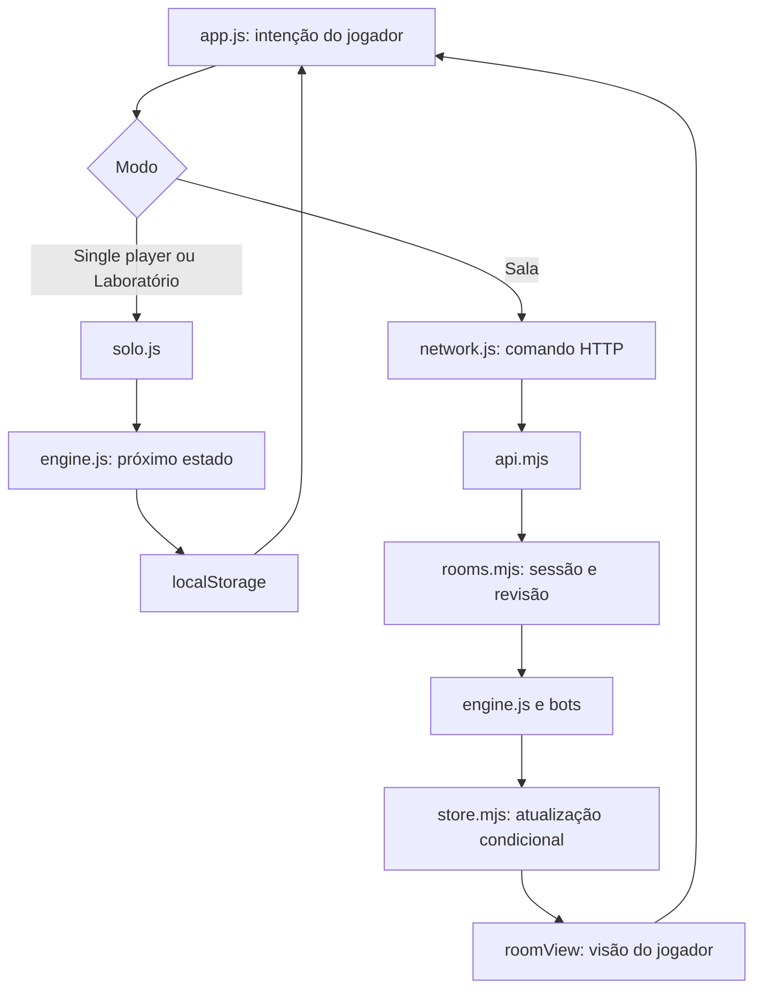
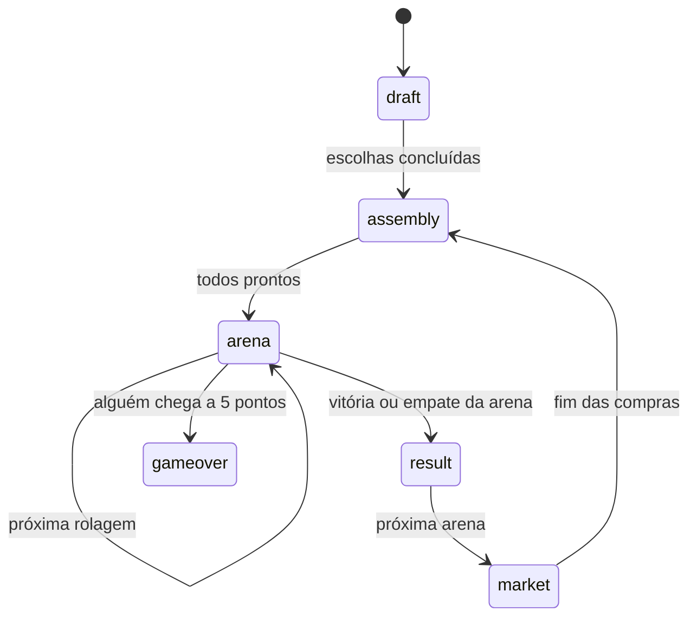

# Como o Mecha Arena funciona

O projeto começou como um jogo de tabuleiro. O código permite experimentar as regras, jogar contra bots e testar muitas partidas sem precisar reproduzir cada movimento à mão. A arquitetura mantém um único motor para a partida local, as salas online e os experimentos.

O caminho mais curto para entender o código é ler `dist/engine.js`, acompanhar uma ação em `dist/solo.js` e, depois, seguir o mesmo percurso por `multiplayer/rooms.mjs`. `dist/app.js` liga esses fluxos à interface.

## Mapa do projeto

| Arquivo ou pasta | Responsabilidade |
| --- | --- |
| `dist/engine.js` | Estado da partida, cartas, fases, ações, combate e validação dos saves. |
| `dist/bots.js` | Perfis e decisões dos bots a partir de informações permitidas. |
| `dist/solo.js` | Partida local, salvamento e seleção das regras do Laboratório. |
| `dist/app.js` | Navegação, composição das telas, interação e coordenação das animações. |
| `dist/network.js`, `dist/profiles.js` | Clientes HTTP, sessão da sala e seleção do perfil público. |
| `dist/arena-playback.js`, `dist/dice-presentation.js` | Relógio, velocidade, dados e efeitos de uma rolagem já resolvida. |
| `dist/market-*.js` | Histórico público, ordem de compra e apresentação das decisões dos bots. |
| `dist/icons.js`, `dist/*.css`, `dist/assets/` | Ícones, estilos e imagens usadas pelo jogo. |
| `multiplayer/api.mjs` | Rotas HTTP comuns ao servidor local e à hospedagem. |
| `multiplayer/rooms.mjs` | Participantes, autorização, comandos, concorrência e visão de cada jogador. |
| `multiplayer/room-bots.mjs` | Avanço dos bots dentro da atualização da sala. |
| `multiplayer/profiles.mjs`, `multiplayer/store.mjs` | Nomes públicos, resultados e persistência condicional. |
| `multiplayer/local-store.mjs`, `server.mjs` | Adaptador SQLite e servidor HTTP em Node.js. |
| `multiplayer/worker.mjs`, `db/`, `drizzle/` | Adaptador Cloudflare D1, esquema e migrações. |
| `simulations/` | Experimentos controlados, torneios e geração de relatórios. |
| `tests/` | Regras, fluxos completos, concorrência, privacidade e apresentação. |

**Apesar do nome, `dist/` contém fontes mantidas diretamente.** Não é uma pasta descartável de build. O empacotamento de hospedagem do checkout de desenvolvimento gera apenas `dist/server/` e `dist/.openai/`; essas saídas não pertencem ao repositório público.

## Uma ação, dois caminhos

No modo local, `soloAction` aplica a ação humana, avança os bots e devolve o próximo estado. A interface salva esse estado no navegador. Nas salas, o cliente envia apenas a intenção; o servidor verifica quem pode agir, aplica o motor e os bots, persiste o resultado e devolve uma projeção do estado.

Por exemplo, `BUY` retira uma carta da oferta e cobra três sucatas. No motor, ela marca a oportunidade como usada. Os adaptadores `soloAction` e `rooms.command` também aplicam `END_TURN` para que o clique de compra conclua a oportunidade. Essa diferença entre uma ação do motor e um gesto da interface é intencional.

## Estado e fases

O estado é um objeto serializável em JSON. `players` contém os robôs; `deck` guarda as cartas disponíveis; `rng` guarda a sequência de sorteios. `draft`, `market` e `preparation` representam decisões em andamento. `lastRoll` registra a última rolagem e seus estados intermediários.

No single player e no Laboratório, `currentPlayer` identifica a vez na escolha inicial, montagem e loja. Nas salas, `prepareTogether` reserva ofertas independentes no mesmo baralho. Cada participante pode terminar as escolhas e montar enquanto os demais ainda escolhem. Por isso, a fase visível ao jogador pode diferir da fase compartilhada. A arena só começa quando todos confirmam; a loja continua sequencial.

`act(input, action, playerId)` e `resolveRoll` produzem um novo estado sem alterar o argumento de entrada. Os auxiliares internos modificam essa cópia de trabalho. A autorização de uma sessão pertence ao serviço de salas, não ao motor.

## Cartas, módulos e conservação

| Código | Equipamento | Efeito comum |
| --- | --- | --- |
| `A` | Canhão | Um dano no adversário vivo mais avançado; empate de alvo é sorteado. |
| `K` | Propulsor | Avança uma casa, até a posição quatro. |
| `Q` | Escudo | Acrescenta um HP máximo quando equipado e cura um ao ativar. |
| `J` | Coletor | Ganha uma sucata ao ativar. |

O código da carta vem da referência ao baralho. `id`, como `A0`, identifica uma carta física; `upgraded` registra sua melhoria. Cada robô tem seis posições em `modules`, correspondentes às faces do dado, e começa com três desbloqueadas. `inventory` é a reserva, limitada a uma carta ao confirmar a montagem.

O jogo normal conserva 32 cartas, oito de cada tipo. Uma tripla transforma uma carta em melhorada e devolve as outras duas ao baralho. Venda também devolve a carta, sem melhoria. Ofertas iniciais e cartas da loja continuam fazendo parte do total. `validateState` verifica essa conservação e rejeita duplicações ou perdas.

`VERSION` é a versão do formato de salvamento. `ruleset` distingue regras experimentais. A versão do `package.json`, os nomes das publicações e `PRAGMA user_version` do banco têm outras funções; não devem ser usados como sinônimos.

## Resolução do combate

1. Sortear os dados dos robôs vivos usando o gerador salvo na partida.
2. Visitar as faces de um a seis e, dentro de cada face, os tipos `A`, `K`, `Q`, `J`.
3. Resolver juntos os robôs que ativam a mesma face e o mesmo tipo.
4. Verificar o fim da arena após o grupo. Um grupo anterior pode impedir a ativação de grupos posteriores.
5. Guardar os eventos e snapshots em `lastRoll` para apresentação e replay.

Ataques simultâneos merecem atenção: cada atacante enxerga a vida anterior ao grupo, descontando apenas seus próprios tiros durante a escolha dos próximos alvos. O dano dos demais atacantes só é aplicado ao fechar o grupo. Assim, receber dano letal simultâneo não cancela o segundo disparo de um Canhão melhorado.

Chegar ao centro ou ser o último sobrevivente dá um ponto. Chegada simultânea, destruição mútua e ausência de Canhão/Propulsor entre todos os sobreviventes encerram a arena sem ponto. Todos recebem três sucatas ao terminar. Posição e HP são restaurados na próxima arena; equipamentos, módulos, sucata e pontos permanecem.

O [Laboratório](LABORATORIO.md) é uma variação local: 36 cartas, kit inicial, carga e críticos. A carga decide a quantidade de dados antes dos ganhos daquela rolagem. A migração de `laboratory-v1` preserva a preparação antiga e acrescenta as cartas necessárias para `laboratory-v2`. `simulations/lab.mjs` é o mecanismo dos experimentos estatísticos, não a implementação desse modo de jogo.

## Bots sem informação privilegiada

`chooseAction` retorna uma ação, sem aplicá-la. `decisionView` e `roomBotDecisionView` fornecem uma cópia apenas do próprio robô, ofertas disponíveis, placar e equipamentos revelados na última arena. Os bots não recebem baralho, RNG, ofertas privadas ou montagens adversárias ainda ocultas.

As personalidades têm pesos e pequenas variações determinísticas por semente. Alterar a ordem de consulta não deve sortear uma nova preferência nem consumir a aleatoriedade do combate. Saves antigos sem personalidade usam a política clássica; `simulations/legacy-bots.mjs` também conserva essa política como controle experimental.

## Salas, identidade e persistência

Um **perfil** é público e selecionado pelo nome, sem prova de identidade. Uma **sessão da sala** é uma credencial privada no navegador, cujo hash identifica o participante no servidor. Abrir o mesmo perfil em outro aparelho não transfere o controle do robô.

Cada comando contém `commandId` e uma revisão. O servidor conserva até 128 recibos por sala: um reenvio recente com o mesmo identificador e ação retorna o estado sem repetir a operação. A preparação usa uma revisão por participante e uma época composta pela partida/arena; mercado e combate usam a revisão geral da sala.

`mutate` tenta salvar somente se a revisão lida ainda for a atual. Em uma disputa, relê o estado e tenta novamente, até oito vezes. A transformação não pode produzir efeitos externos, pois pode ser executada mais de uma vez. No fim da partida, a atualização da sala e a gravação dos resultados compartilham uma transação. A chave partida/perfil e a comparação do estado salvo evitam crédito duplicado.

`roomView` usa uma lista explícita de campos permitidos. Baralho, RNG, tokens e reservas alheias não saem do servidor. Equipamentos adversários só aparecem quando revelados. Uma visão online é deliberadamente incompleta: não deve ser passada ao motor como se fosse um save local.

## Interface e apresentação

`app.js` usa funções de template e eventos delegados no documento. `render` substitui a árvore principal, preservando foco e rolagem quando possível. Durante arraste ou replay, uma atualização recebida fica em `queuedView`; somente a mais recente é aplicada ao terminar a interação.

As animações leem snapshots já resolvidos. Velocidade, movimento reduzido e replay não mudam regras nem sorteios. Os módulos pequenos de apresentação permitem testar esse comportamento sem navegador real.

O CSS é incremental. `styles.css` inclui uma base antiga e refinamentos posteriores; as folhas específicas seguem a ordem de `index.html`. Reordenar ou eliminar seletores aparentemente repetidos pode mudar a cascata. Uma futura consolidação merece uma tarefa própria com comparação visual em desktop.

Veja [como executar e validar](DESENVOLVIMENTO.md) e [como jogar](JOGAR.md).
